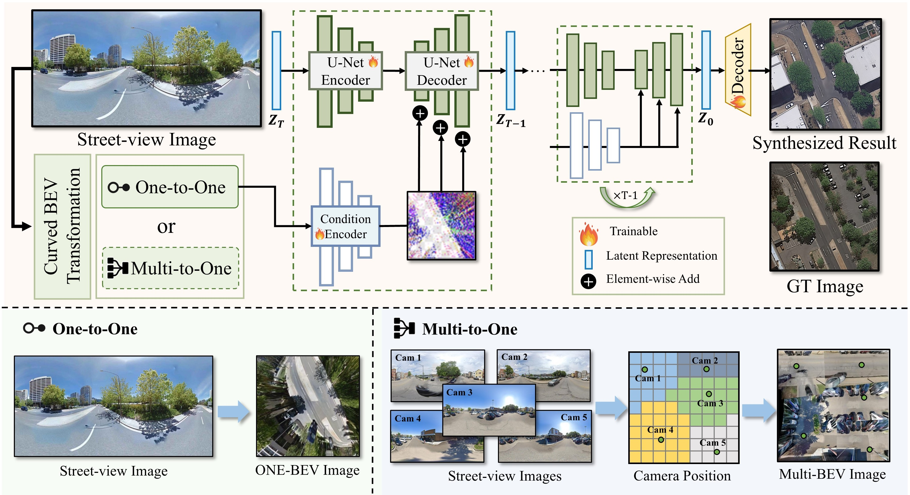

<div align="center">
	
	<h1>Ground-to-Aerial Image Synthesis with  Diffusion Models and BEV Paradigm</h1>
	<a href="https://arxiv.org/abs/2408.01812"></a>
	<a href="https://opendatalab.github.io/skydiffusion/"></a>
	<a href="https://huggingface.co/datasets/Yejy53/G2A-3"></a>
	<a href=""></a>
	<a href=""></a>
</div>


<div align="center">

[Junyan Ye\*](https://yejy53.github.io/), Jun He\*, [Weijia Li?](https://liweijia.github.io/), Zhutao Lv, Yi Lin, Jinhua Yu, Haote Yang,  [Conghui He](https://conghui.github.io/)

Sun Yat-Sen University, Shanghai AI Laboratory, Sensetime Research

</div>



## ? News

* **\[2025.06]**  ? We are very happy to announce that SKydiffusion has been accepted by ICCV 2025??
* **\[2024.11]**  ?? We released the Dataset G2A-3.  Check out the [Dataset](https://huggingface.co/datasets/Yejy53/G2A-3/tree/main).
* **\[2024.11]**  ? We released the training and testing code
* **\[2024.08]**  ? We have released **Skydifussion: Ground-to-Aerial Image Synthesis with  Diffusion Models and BEV Paradigm**. Check out the [paper](https://arxiv.org/abs/2408.01812). The code and dataset are coming soon


## ? Contributions

**Main methods??** We introduce SkyDiffusion, a novel ground-to-aerial synthesis method leveraging diffusion models and BEV paradigm to generate realistic, consistent aerial images.

**Method innovation details??** We design a Curved-BEV method to transform street-view images into satellite views for domain alignment. It also includes "Multi-to-One" mapping strategy to enhance BEV perception range in densely occluded urban areas.

**Dataset Contribution??** We introduce Ground2Aerial-3, a new ground-to-aerial image synthesis dataset, featuring disaster scene aerial image, historical high-resolution satellite image, and low-altitude UAV image

**Experimental results??** We introduce Ground2Aerial-3, a new ground-to-aerial image synthesis dataset, featuring disaster scene aerial image, historical high-resolution satellite image, and low-altitude UAV image

## ??? Requirements and Installation

Clone this repo to a local folder:

```bash
git clone https://github.com/unameable/skydiffusion-main.git
cd skydiffusion-main/skydiffusion-main
```

We provide an available conda environment named skydiffusion. You can configure the necessary Python environment for the experiments by following these steps:

```bash
conda env create -f environment.yaml
conda activate skydiffusion
```

## Data Preparation

The publicly available datasets used in this paper can be obtained from the following sources:

**Preparing G2A-3 Dataset.**  The dataset can be downloaded [here](https://huggingface.co/datasets/Yejy53/G2A-3/tree/main).

**Preparing CVUSA Dataset.**  The dataset can be downloaded [here](https://mvrl.cse.wustl.edu/datasets/cvusa).

**Preparing CVACT Dataset.**  The dataset can be downloaded [here](https://github.com/Liumouliu/OriCNN).

**Preparing VIGOR Dataset.**  The dataset can be downloaded [here](https://github.com/Jeff-Zilence/VIGOR/tree/main).

### 下载与解压

G2A-3 的文件列表提供以下压缩包，可按需点击下载：

| 子集 | 下载链接 | 压缩包大小（约） |
| --- | --- | --- |
| History | [History.zip](https://huggingface.co/datasets/Yejy53/G2A-3/resolve/main/History.zip?download=true) | 1.41 GB |
| UAV | [UAV.zip](https://huggingface.co/datasets/Yejy53/G2A-3/resolve/main/UAV.zip?download=true) | 7.11 GB |
| Disaster | [disaster.zip](https://huggingface.co/datasets/Yejy53/G2A-3/resolve/main/disaster.zip?download=true) | 2.77 GB |

已在项目内创建 [datasets/](datasets/README.md) 目录，可将压缩包下载并解压到对应子目录，例如 `./datasets/G2A-3/`。目前这些目录仅包含占位文件，尚未下载数据，也未创建训练清单。数据内容会被 Git 忽略。所有相对路径以内层项目目录为基准。以上链接是数据文件，不是模型权重；解压后应根据实际目录及配对信息生成训练清单。

#### 命令行下载 G2A-3（Windows PowerShell）

从仓库根目录打开 PowerShell，先进入内层项目目录。如果已经在包含 `skydiffusion_train.py` 的目录，请跳过第一行 `cd`：

```powershell
cd skydiffusion-main
New-Item -ItemType Directory -Force -Path ./datasets/G2A-3 | Out-Null

curl.exe --location --fail --retry 5 --retry-delay 5 --continue-at - --output ./datasets/G2A-3/History.zip "https://huggingface.co/datasets/Yejy53/G2A-3/resolve/main/History.zip?download=true"
curl.exe --location --fail --retry 5 --retry-delay 5 --continue-at - --output ./datasets/G2A-3/UAV.zip "https://huggingface.co/datasets/Yejy53/G2A-3/resolve/main/UAV.zip?download=true"
curl.exe --location --fail --retry 5 --retry-delay 5 --continue-at - --output ./datasets/G2A-3/disaster.zip "https://huggingface.co/datasets/Yejy53/G2A-3/resolve/main/disaster.zip?download=true"
```

可只运行需要的压缩包对应命令。这里显式使用 `curl.exe`，避免旧版 PowerShell 将 `curl` 解释为其他命令；无需安装 Python 下载库，也无需启动训练环境。`--location` 跟随下载重定向，`--fail` 将 HTTP 错误视为失败，`--continue-at -` 从已有文件大小处续传。网络中断后重新运行同一条命令即可尝试继续下载；确认命令无错误且下载完整后再解压。三个压缩包合计约 11.3 GB，解压还需要额外磁盘空间。

下载成功后，在同一目录执行以下解压命令（只下载了某个包时，只执行对应行）：

```powershell
Expand-Archive -LiteralPath ./datasets/G2A-3/History.zip -DestinationPath ./datasets/G2A-3/History
Expand-Archive -LiteralPath ./datasets/G2A-3/UAV.zip -DestinationPath ./datasets/G2A-3/UAV
Expand-Archive -LiteralPath ./datasets/G2A-3/disaster.zip -DestinationPath ./datasets/G2A-3/disaster
```

大压缩包如果无法用 `Expand-Archive` 解压，可用 7-Zip 解压到相同目录。压缩包内部可能还有目录层级，请根据实际解压内容创建配对清单。

#### 浏览器下载备用方式

如果命令行无法连接 Hugging Face，打开上表的下载链接，或在 [Files and versions 页面](https://huggingface.co/datasets/Yejy53/G2A-3/tree/main) 点击对应 `.zip` 行右侧的下载箭头，将文件保存到 `datasets/G2A-3/`。不需要下载 `.gitattributes` 和 `README.md`。若浏览器也无法访问，请先解决网络连接问题；浏览器下载不能绕过站点不可达的问题。

CVUSA 按官方页面提供的下载说明获取；本次链接核查时该站返回 502，如暂时无法访问请稍后重试。CVACT 作者页面要求联系作者申请数据，并注明仅限研究、不得再分发；按该页面的最新说明操作。VIGOR 的下载入口见其官方项目 README。

### 整理为本项目的训练格式

当前单幅训练入口的全景几何参数仅支持 `CVACT` 和 `CVUSA`。列出 G2A-3 / VIGOR 下载入口不表示原始数据可以直接传入训练；其他数据需要先完成配对与朝向对齐，并准备 RGB BEV 条件图，再使用 `--source-mode bev`。

1. 根据数据集配对标注建立街景与航拍图的对应关系，保留官方划分；自建划分时避免相同地点跨训练集和验证集。
2. 创建 `train.csv` 和 `val.csv`，每行一个配对样本。路径默认相对于清单所在目录，也可使用绝对路径。示例结构由使用者整理，不代表压缩包原始目录：

```csv
name,source,target,prompt
sample_001,street/001.jpg,aerial/001.png,
sample_002,street/002.jpg,aerial/002.png,
```

3. 在内层项目目录运行数据检查，例如已经整理好的 CVACT 全景数据：

```powershell
python skydiffusion_train.py --train-data ./datasets/CVACT/train.csv --val-data ./datasets/CVACT/val.csv --dataset-name CVACT --check-data
```

CVUSA 使用 `--dataset-name CVUSA`；预先生成的 BEV 图加入 `--source-mode bev`。检查 `training_runs/single_image/data_preview/` 中的 BEV 与真值预览，确认朝向和配对后再训练。完整参数、旧格式兼容规则和训练命令见 [TRAINING_SINGLE_IMAGE.md](TRAINING_SINGLE_IMAGE.md)。仓库内 `examples/examples.txt` 和图片仅用于小样本检查，不能替代独立的训练、验证数据集。


## ? Quick Start

Run commands from the inner project directory. Checkpoints are not included: prepare a compatible trained SkyDiffusion model using [models/README.md](models/README.md). The environment specifies Python 3.8.5, PyTorch 1.12.1 and Lightning 1.5.0. Inference requires CUDA-enabled PyTorch and a compatible NVIDIA GPU. Fresh environment installation has not been verified on every platform.

The following single-line command works in PowerShell and Bash:

```powershell
python skydiffusion_test.py --num_gpus=1 --batch_size=1 --config_path=./models/lacldm_v15.yaml --image_width=512 --image_height=512 --result_dir=./results/cvact --model_path=./models/CVACT_SkyDiffusion.ckpt --data_file_path=./examples/examples.txt --dataset_name=CVACT
```

The example manifest is tab-separated and its paired images are included. Inference requires both panorama and ground-truth aerial images. CLIP downloads on first use; for offline inference add `--clip_model ./clip-vit-large-patch14` after preparing the files in the weight guide.

Match preprocessing to your checkpoint. The default rotation is 90 degrees; historical upstream weights may require `--rotation_degrees=0`. For models trained here, use the saved `model_config.yaml` and the same BEV settings as training. Ordinary perspective photographs cannot be treated as panoramas.

Historical evaluation scripts are not a validated unified evaluation pipeline; see [eval/README.md](eval/README.md) for dependencies and limitations.

## BibTeX ?

If you have any questions, be free to contact with me!

```
@article{ye2024skydiffusion,
  title={SkyDiffusion: Street-to-Satellite Image Synthesis with Diffusion Models and BEV Paradigm},
  author={Ye, Junyan and He, Jun and Li, Weijia and Lv, Zhutao and Yu, Jinhua and Yang, Haote and He, Conghui},
  journal={arXiv preprint arXiv:2408.01812},
  year={2024}
}
```

## License

This project is licensed under the Apache 2.0 License. See the [LICENSE](LICENSE) file for details.


## Single-image training

单幅街景到航拍图的训练、权重初始化、数据检查和断点恢复见 [TRAINING_SINGLE_IMAGE.md](TRAINING_SINGLE_IMAGE.md)。
